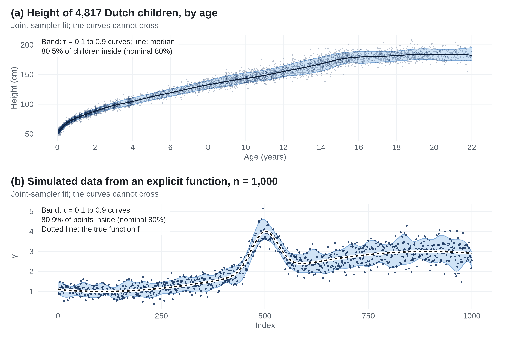

# Bayesian Joint Quantile Trend Filtering

[](https://www.r-project.org/)
[](https://lean-lang.org/)
[](#formal-verification-in-lean)
[](#citation-and-license)

This repository has the code, the paper and the Lean proofs for
**Bayesian Joint Quantile Trend Filtering via Proximal MCMC with Sequential Gibbs Sampling**,
by Felipe Bedoya, Meng Li (Department of Statistics, Rice University) and
Eric C. Chi (School of Statistics, University of Minnesota).

## The main idea behind this project

Quantile trend filtering estimates a conditional quantile by combining the
check loss with an ℓ1 penalty on the differences of order k+1 of the trend. It returns a point
estimate, and the penalty has to be selected. We give it a Bayesian counterpart: an asymmetric
Laplace working likelihood, a Laplace prior on the differences, and priors on the penalty and the
scale. The output is a posterior, with no cross-validation. A joint version fits several quantile levels together, and its draws never cross.

Theorem 1 takes independent observations, k ≥ 1, and true quantiles whose total variation of
order k+1 is bounded (V* ≤ V̄). For a fixed scale and a deterministic penalty of order
n^((2k+1)/2), the posterior contracts around them at the rate n^(-(2k+1)/(2k+2)) in the Δ²ₙ
loss: n^(-5/6) for k = 2, with no logarithmic factor. The noise needs local bounds on its
distribution functions near the quantile, and no moment. Theorem 2 gives the same rate at every
level of the non-crossing joint posterior at once, for finitely many fixed levels, with no
additional separation assumption. Both theorems are machine-checked in Lean 4
([`lean/`](lean)). The theorems hold the penalty and the scale fixed; the samplers place priors
on both, and that case is not covered.

The normal-exponential representation of that likelihood makes the conditional
of the trend a weighted quadratic plus the ℓ1 difference penalty. A proximal Metropolis-adjusted
Langevin step updates the trend; its proximal map is a weighted trend filtering problem on this
whole conditional, not on a smoothed check loss, and the accept-reject step uses the exact
density. For one level the map is a fixed number of banded ADMM iterations, so a sweep is linear
in n: a median 2.0 ms at n = 250 and 36.6 ms at n = 4,000 (τ = 0.5, k = 2, one laptop core). In the joint sampler the map is box-constrained: the same ADMM when no
bound binds, otherwise banded interior-point steps, each linear in n.



*Bands between jointly sampled 0.1 and 0.9 quantile curves; both fits are by the joint sampler, and the curves cannot cross. (a) Height of 4,817 Dutch children; the band holds 80.5% of them (nominal 80%). (b) n = 1,000 points simulated from the explicit function f(u) = 2 + sin(4u − 2) + 2·exp(−30(4u − 2)²), with u = i/1000, plus Gaussian errors with standard deviation (1 + u²)/4; the band holds 80.9% of the points (nominal 80%); dotted: f.*

In the peak-detection simulation of Brantley et al. (2020) for air-quality sensors, the MSE for
the peak-free baseline is [E-18: MSE PMALA, τ = 0.01] for the sampler against
[E-18: MSE ADMM, τ = 0.01] for ADMM quantile trend filtering at τ = 0.01,
[E-18: MSE PMALA, τ = 0.05] against [E-18: MSE ADMM, τ = 0.05] at τ = 0.05, and
[E-18: MSE PMALA, τ = 0.10] against [E-18: MSE ADMM, τ = 0.10] at τ = 0.10; the sampler selects
no penalty. [E-18: one sentence on which method is ahead at which level.] On one day of fenceline
sensor readings (n = 8,640), [E-18: one sentence on the fitted baselines].

## Our work

The samplers and the proofs run on a laptop. The simulation campaigns ran on a Slurm
cluster from frozen packages; each experiment folder ships its summaries.

| In the paper | Folder | How to run | Time |
|---|---|---|---|
| Section 2, Algorithms 1–2: the two samplers | [`method/`](method) | from the repository root: `Rscript method/individual/Individual_Sampler_PMALA_Augmented.R test`; `Rscript method/joint/Joint_Sampler_PMALA_Augmented.R test_prox` | [Eng: time of a complete run, after F12]; [Eng: time of a complete run with `clarabel`] |
| Section 3 and Appendix A: Theorems 1 and 2 | [`lean/`](lean) | in `lean/`: `lake exe cache get`, `lake build`, `lake env lean AxiomCheck.lean` | about 15–20 min on 3 cores, with the prebuilt Mathlib |
| Section 4.1 and Appendix D: simulations at interior levels (Tables 1–2) | [`experiments/interior_quantiles/`](experiments/interior_quantiles) (the individual-sampler package of 2026-10-03) | shipped: `paper_reference/simulations.tex` and `paper_reference/appendix_pmala.tex` in that package. Full run, on a Slurm cluster: `bash submit.sh RUN_NAME` from the package folder | 3,000 cluster tasks |
| Section 4.1 and Appendix D: joint estimation of extreme upper levels (Tables 3–4), crossing tables | [`experiments/extreme_quantiles/`](experiments/extreme_quantiles), [`experiments/joint_upper_levels/`](experiments/joint_upper_levels) | shipped: `experiments/extreme_quantiles/tables_20261023/mse_consolidated_oct7.csv`, `experiments/extreme_quantiles/tables_20261008/crossings_*.csv`, `experiments/joint_upper_levels/paper_reference/table2_mse.csv`. Full joint run, on a Slurm cluster: `cd experiments/joint_upper_levels && bash submit.sh RUN_NAME` | 300 cluster tasks for the joint run |
| Section 4.2: cost per sweep (Table 5, Figures 1–2) | [`experiments/scalability/`](experiments/scalability) | see the paper's table; the script is being updated | |
| Section 4.3: air-quality simulation (Table 6) | [`experiments/air_simulation/`](experiments/air_simulation) | [E-18: command] | [E-18] |
| Section 4.4: air-quality sensor data | [`applications/Air Quality/`](applications/Air%20Quality) | [E-18: command] | [E-18] |
| Section 4.4 and Appendix E: growth centiles | [`applications/Growth/`](applications/Growth) | in `applications/Growth/`: `Rscript Growth_plots_k2.R` redraws the figures of the shipped joint-sampler fit and overwrites `results_joint_k2/figures/growth_joint_*`; `Rscript Growth_Joint_PMALA_k2.R sex=boy out=results_refit/boy` refits the boys into a new folder | [Eng: time]; [Eng: time] |
| The figure above | [`examples/readme_figures/`](examples/readme_figures) | `Rscript examples/readme_figures/make_readme_figures.R` | [Eng: time on a laptop] |
| The paper | [`paper/`](paper) | read `main.pdf`, or in `paper/`: `latexmk -pdf main.tex` | |

The linked folders have a README with the settings, the commands and the outputs.

The growth fit shipped in `applications/Growth/results_joint_k2/` is a joint-sampler fit of five
levels. The growth figures of the paper come from fits of one level at a time, and the script that
draws them is not in this repository; the same holds for the figures `spod_*` and `scal_*`.

<!--
W-08, owner addition B (FABLE). Draft of the Lean section of the top-level README.
Status: DRAFT for the Lean department head to fact-check. Not final until the head signs.

Sources allowed by the brief, and the only ones used:
  lean/README.md, lean/AxiomCheck.lean, lean/notes/ (PAPER_CORRECTIONS.md, reviews/, logs/),
  lean/notes/reviews/FINAL_AUDIT_astra.md.
Every claim below is followed by an HTML comment "src:" with file:line. Line numbers are those of the
working tree on 2026-11-26 (lean/ last touched by commit f7aa3c6).
The module map also uses the list of file names under lean/BQTF (git ls-files); file names only.
Paths in links are relative to the repository root, since this text goes into the top-level README.

Items the head must decide are collected at the end ("For the Lean head"). They are in comments and
do not print.
-->

## Formal verification in Lean

Both contraction theorems of the paper are proved in [Lean 4](https://lean-lang.org/) with Mathlib, in [`lean/`](lean). A proof assistant checks every step of a proof down to the axioms, so the theorems do not rest on a referee having read the appendix line by line.
<!-- src: lean/README.md:5 ("machine-checked proofs, in Lean 4 with Mathlib, of the paper's two posterior-contraction theorems") -->

### What is proved

| Paper | In plain words | Lean statement | Proved by |
|---|---|---|---|
| Theorem 1, σ = 1 | For independent data whose distribution functions grow at least and at most linearly near the τ-quantile (Assumptions A and B), a true trend whose total variation of order r = k + 1 (the paper's TV^(r)) is at most V̄, and a penalty λ = c·n^((2k+1)/2), the expected posterior mass of the trends whose loss Δ²ₙ exceeds M·n^(−(2k+1)/(2k+2)) is at most C·n^(−1/(2k+2)). There is no logarithmic factor. | `MainStatement` | `main_theorem` |
| Theorem 1, any fixed scale σ₀ > 0 | The same bound, with constants that may also depend on σ₀. | `MainStatementScale` | `main_theorem_scale` |
| Theorem 2, unit scales | For J quantile levels fitted jointly under the non-crossing constraint, the same bound holds for the largest of the J losses, so all levels contract at the same rate at once. | `JointStatement` | `joint_theorem` |
| Theorem 2, any fixed scales σ₀ⱼ > 0 | The same, with a separate scale at each level. | `JointStatementScale` | `joint_theorem_scale` |
<!-- src (names, files): lean/README.md:32-37; lean/AxiomCheck.lean:9-10,17-18 -->
<!-- src (Thm 1 in words): FINAL_AUDIT_astra.md:25-32 (k≥1, level in (0,1), independent laws, margins A and B, TV bound, λ=c n^((2k+1)/2), event Δ²ₙ>M n^(-(2k+1)/(2k+2)), bound C n^(-1/(2k+2)), "without a logarithm") -->
<!-- src (Thm 1 scale): FINAL_AUDIT_astra.md:36-38 ("adds σ₀>0 before the constants"; "M,C,n₀ may additionally depend on σ₀") -->
<!-- src (Thm 2 in words): FINAL_AUDIT_astra.md:44-48 (finite J, same single-level premises at each level, posterior restricted to trends weakly increasing in j, "strict maximum-loss event", "both exponents of Theorem 1") -->
<!-- src (Thm 2 scales): FINAL_AUDIT_astra.md:52-54 ("arbitrary positive σ₀ⱼ"; "Each level divides its own check loss by its own scale") -->

The observations need not be identically distributed and no moment is assumed. The asymmetric Laplace density is a working likelihood only.
<!-- src: FINAL_AUDIT_astra.md:26 ("Distinct marginal laws and infinite data moments are allowed") -->
<!-- NOTE for the head: "working likelihood only" is the paper's wording (theory.tex), not in the allowed sources. FINAL_AUDIT:26,29 support "product of arbitrary marginal laws" and "working check loss". Keep or cut. -->
<!-- Lean head: KEEP. It is accurate. In Lean, the posterior is built from the check loss (asymmetric Laplace kernel), and the data law is an arbitrary product of marginals, unrelated to that kernel (BQTF/Spec.lean; FINAL_AUDIT_astra.md:26,29). -->

In Theorem 2 the true quantile curves are not assumed to be separated, and nothing is assumed about independence across levels: every level uses the same observations.
<!-- src: FINAL_AUDIT_astra.md:45 ("No additional separation of the truth or independence across levels is assumed"; "All levels use one vector of independent observations") -->

The four statements are collected in [`lean/BQTF/Spec.lean`](lean/BQTF/Spec.lean). [`lean/docs/statements.md`](lean/docs/statements.md) explains each one in plain mathematics, so you can compare it with the paper without reading Lean.
<!-- src: lean/README.md:39 -->

### Why you can trust it

- **No `sorry`.** Nothing is left unproved.
  <!-- src: lean/README.md:10; source scan FINAL_AUDIT_astra.md:105-109 (pattern sorry|admit|native_decide|axiom |unsafe|implemented_by|set_option; sole match is a heartbeat limit, Main.lean:233) -->
- **Standard axioms only.** `#print axioms` on each of the four theorems lists `propext`, `Classical.choice` and `Quot.sound`, the three axioms of ordinary mathematics in Lean, and nothing else. This was last checked, with a full build and the source scan, at commit f64025a. No Lean source, lakefile, manifest or toolchain file has changed since.
  <!-- Lean head (2026-11-26): confirmed. Full build, AxiomCheck and the source scan on main at f64025a (Polish_2026-11-26.md, rulings). Later lean/ commit f7aa3c6 touched docs and SHA256SUMS only. A from-scratch rebuild of BQTF at 19be187, whose lean/ tree equals f7aa3c6's, repeated AxiomCheck. -->
  <!-- Lean head: the audit at 5c3d923 and the later polish are kept separate on purpose. The CLEAN verdict is the audit's, at 5c3d923. The D12 change and the docstrings came after it and were reviewed separately (PolishDocstrings_Astra_2026-11-26.md, at 7ea4cfc). 11 commits touch lean/ after 5c3d923. -->
  <!-- src: lean/README.md:10; lean/AxiomCheck.lean:12-13,20-21; printed output FINAL_AUDIT_astra.md:84-87; again after the polish pass, PolishDocstrings_Astra_2026-11-26.md:3 -->
- **The statements are pinned.** [`lean/AxiomCheck.lean`](lean/AxiomCheck.lean) contains lines such as `example : MainStatement := main_theorem`. They compile only if each theorem has exactly the type written in `Spec.lean`, so a proof of something weaker cannot pass under the same name.
  <!-- src: lean/README.md:25; lean/AxiomCheck.lean:4-5,9-10,17-18 -->
- **Independent final audit: CLEAN.** A reviewer who wrote none of the proofs compared the four compiled statements with the paper, hypothesis by hypothesis, and reran the axiom check and the source scan. The verdict: all four Lean statements imply their paper counterparts, with no gap in any of them.
  <!-- src: FINAL_AUDIT_astra.md:1 (title "Independent final audit at 5c3d923"); :3 ("CLEAN. All four compiled propositions imply their paper counterparts."); :32,38,48,54 ("Top-level gaps: none." x4); :73 ("No blocker, major or minor fidelity gap in the four top-level statements"); :77-109 (commands and output) -->
  <!-- Lean head: CONFIRMED. The final auditor was a fresh agent launched for the audit, with no part in writing or reviewing the proofs (audit brief, 2026-11-26). -->
- **Every module was reviewed.** Every source file is covered by a dated code review in [`lean/notes/reviews/`](lean/notes/reviews), written by a reviewer who did not write that file. The statements were audited separately, in [`lean/notes/audits/`](lean/notes/audits). Every finding was ruled on.
  <!-- src: lean/README.md:67 ("per-module code reviews"); PAPER_CORRECTIONS.md:12 ("a fresh Sol review has passed, and the head has ruled on every finding"); 29 dated review files in lean/notes/reviews/ besides the final audit -->
  <!-- Lean head: checked file by file. Each of the 56 files under lean/BQTF is named in at least one review. Some reviews cover a group of files: for example, the Denominator review covers Asym/*, and the SmallBall review covers Lin/GaussianSmallBall and LaplaceMixture. So "every source file is covered", not "each module has its own review". -->

### Classical results proved from scratch

No classical result enters as a hypothesis. Where Mathlib did not have a result the proofs need, it is proved in this repository:
<!-- src: lean/README.md:10 ("No classical result enters as a hypothesis.") -->

| Result | Lean declaration | File |
|---|---|---|
| Efron–Stein inequality, one-sided form | `BQTF.Prob.efronStein_oneSided` | `lean/BQTF/Prob/EfronStein.lean` |
| Rademacher contraction principle (Ledoux–Talagrand, Theorem 4.12) | `BQTF.Prob.contraction_abs` | `lean/BQTF/Prob/Contraction.lean` |
| Symmetrization for finite empirical processes (van der Vaart and Wellner, Lemma 2.3.6) | `BQTF.Prob.symmetrization_finset` | `lean/BQTF/Prob/Symmetrization.lean` |
| Eckart–Young tail bound for singular values (Frobenius form) | `BQTF.Lin.eckartYoung_tail` | `lean/BQTF/Lin/EckartYoung.lean` |
| Prékopa–Leindler inequality: the functional form on ℝ, tensorized to the product Laplace law on ℝᵈ. The proof uses it as joint log-concavity of the Laplace slice mass. | `BQTF.PL.pl_one`, `BQTF.PL.plProp_Qlam`; applied in `BQTF.prekopa_laplace` | `lean/BQTF/Shift/PrekopaLaplace/OneDim.lean`, `…/Tensor.lean`, `lean/BQTF/Shift/PrekopaLaplace.lean` |
<!-- src Efron–Stein: lean/README.md:10; PAPER_CORRECTIONS.md:85 (name and file) -->
<!-- src contraction: lean/notes/logs/cp_opus2_progress.md:1 ("Ledoux–Talagrand contraction (BQTF.Prob.contraction_abs)"); reviews/Contraction_2026-11-25.md:1,60 ("The paper cites Ledoux–Talagrand Thm 4.12"); logs/neonB_questions.md:50,61 (not in Mathlib) -->
<!-- src symmetrization: reviews/Concentration_2026-11-25.md:31 (file), :79 ("concentration and symmetrization_finset use the standard 3 axioms only"); PolishDocstrings_Astra_2026-11-26.md:20 (the three modules supply symmetrization_finset, contraction_abs, efronStein_oneSided) -->
<!-- src Eckart–Young: lean/README.md:10 ("the Eckart–Young tail bound"); reviews/EckartYoung_2026-11-25.md:1,10; PolishDocstrings_Astra_2026-11-26.md:11 -->
<!-- src Prékopa–Leindler: lean/README.md:10; PolishDocstrings_Astra_2026-11-26.md:17 ("prekopa_laplace in Shift/PrekopaLaplace proves joint log-concavity of the product-Laplace slice mass"); reviews/QuadShift_2026-11-26.md:57 ("the proved Prékopa–Leindler slice result") -->
<!-- NOTE for the head (1): lean/README.md:10 names three results (Efron–Stein, Eckart–Young, Prékopa–Leindler). The brief asks for five. Contraction and symmetrization are supported by the notes cited above but not by lean/README.md. Confirm that both are proved here without a hypothesis, and consider adding them to lean/README.md:10 so the two READMEs agree. -->
<!-- NOTE for the head (2): PolishDocstrings:17 calls the Prékopa result a "product-Laplace slice specialization" (row label "Scope"). I therefore do not write "the Prékopa–Leindler inequality" without the qualifier. lean/README.md:10 does. Decide which wording is right and use it in both places. -->
<!-- NOTE for the head (3): the fully qualified names of symmetrization_finset and prekopa_laplace are not given in the notes; I wrote them unqualified. -->
<!-- Lean head, ON (1)-(3), 2026-11-26:
  - All five results are proved in-tree with no hypothesis standing in for the classical result. `#print axioms` gives [propext, Classical.choice, Quot.sound] for each of: BQTF.Prob.efronStein_oneSided, BQTF.Prob.contraction_abs, BQTF.Prob.symmetrization_finset, BQTF.Lin.eckartYoung_tail, BQTF.PL.pl_one, BQTF.PL.plProp_Qlam and BQTF.prekopa_laplace.
  - Prékopa–Leindler: the full functional inequality is proved, not only the slice specialization. pl_one is Prékopa–Leindler for Lebesgue measure on ℝ (via a one-dimensional weighted Brunn–Minkowski). Tensor.lean shows it is stable under products, measure-preserving linear equivalences and log-concave densities, which gives plProp_Qlam for the product Laplace law on ℝᵈ. prekopa_laplace (PolishDocstrings:17) is the specialization the proof uses. Both READMEs now say "functional form on ℝ, tensorized to the product Laplace law".
  - lean/README.md:10 now lists all five.
  - Fully qualified names: BQTF.Prob.symmetrization_finset, BQTF.prekopa_laplace, BQTF.Lin.eckartYoung_tail, BQTF.Prob.contraction_abs, BQTF.Prob.efronStein_oneSided. eckartYoung_tail is outside the inner EckartYoung namespace, which ends at EckartYoung.lean:112. -->


### What the formalization changed in the paper

Formalizing the proofs found eleven places where the paper's argument needed a fix, numbered C-01 to C-11 in [`lean/notes/PAPER_CORRECTIONS.md`](lean/notes/PAPER_CORRECTIONS.md): missing cases, side conditions that were not stated, and intermediate claims that were wrong as written. None changes the statement of a theorem or a rate. All eleven are now in the paper, and each was checked against the Lean declaration that settles it.
<!-- src count and summary: lean/README.md:57 ("eleven places ... missing cases, unstated side conditions, or a wrong intermediate claim. None changes a theorem statement or a rate.") -->
<!-- src C-01..C-11 headings: PAPER_CORRECTIONS.md:31,42,52,61,70,79,95,104,113,122,138 (eleven "## C-xx" headings, none skipped) -->
<!-- src "in the paper" and "checked": status lines PAPER_CORRECTIONS.md:40 (C-01 verified; fix already in the paper at 906be2b, :35-37), :50 (C-02), :59 (C-03), :68 (C-04), :77 (C-05), :86 (C-06), :102 (C-07), :111 (C-08), :120 (C-09), :136 (C-10), :145 (C-11); each reads "in paper (<hash>)" and "verified" -->
<!-- NOTE for the head: please confirm line 145 (C-11) ends with "verified" as the others do; I read "in paper (3cae0ec); verified (2026-11-26, Lean head)". -->
<!-- Lean head: CONFIRMED. All eleven status lines (40, 50, 59, 68, 77, 86, 102, 111, 120, 136, 145) read "verified", and C-02 to C-11 each carry an "in paper (<hash>)". Theory confirmed every one. -->
<!-- Lean head: the C-06, C-07 and C-02/C-11 examples were checked against PAPER_CORRECTIONS. All three are accurate. -->

Three examples:

- **C-06.** The variance bound for a supremum used a two-sided change bound that holds only one-sided. The fix uses the one-sided Efron–Stein inequality; the bound is unchanged.
  <!-- src: PAPER_CORRECTIONS.md:79 (heading), :83 (fix; "The stated bound is unchanged"), :84 ("a wrong proof step") -->
- **C-07.** A second-moment bound was proved only for positive shifts, and the printed formula was false for negative ones. The fix adds the negative case with the same constant.
  <!-- src: PAPER_CORRECTIONS.md:95 (heading), :98-100 ("For t < 0 the displayed representation is false"; "The constants are unchanged") -->
- **C-02 and C-11.** The theorems take the expectation of the posterior probability of a set, but the paper never said that this probability is a measurable function of the data. Lean proves it as part of each conclusion.
  <!-- src: PAPER_CORRECTIONS.md:42-48 (C-02), :138-144 (C-11); lean/README.md:46 (D3, D8) -->

### Where Lean differs from the paper

Both theorems have the paper's hypotheses and conclusions. [`lean/docs/statements.md`](lean/docs/statements.md) lists every difference, D1 to D12, with its direction:
<!-- src: lean/README.md:43 -->

- **Equivalent reformulations** (D1, D2, D4, D5, D9), for example the assumptions stated coordinate by coordinate and the posterior written with its normalizer.
  <!-- src: lean/README.md:45; FINAL_AUDIT_astra.md:60,61,63,64,68 ("Equivalent" for D1, D2, D4, D5, D9) -->
- **Stronger conclusions** (D3, D8): measurability of the posterior mass is proved as part of the theorem.
  <!-- src: lean/README.md:46; FINAL_AUDIT_astra.md:62,67 ("Stronger conclusion") -->
- **Safe generalizations** (D6, D7, D11): the level spacing enters through a lower bound, both in Theorem 2 and in the gap lemma, and the number of levels is any natural number.
  <!-- Lean head: CORRECTED. The old text "the gap lemma needs Assumption B only" implied the paper's lemma needs more, but the paper's Lemma gap (appendix_theory.tex, \label{pf:lem:gap}) also assumes B only. The generalization in D11 is that `level_gap_of_assB` accepts any lower bound gmin on the adjacent spacings; the minimum spacing gives the paper's g₀ exactly (PolishDocstrings_Astra_2026-11-26.md, D11). -->
  <!-- src: lean/README.md:47,50; FINAL_AUDIT_astra.md:65,66,70 ("Safe" for D6, D7, D11) -->
- **Lemma sup** (D12) is proved on the paper's named event, as `supNorm_concentration_events`, so it matches the paper.
  <!-- src: lean/README.md:51,55 ("Since then, the named-event version supNorm_concentration_events has been added, so Lemma sup now matches the paper"); PolishDocstrings_Astra_2026-11-26.md:28 -->
- **One difference is weaker than the paper** (D10). Two constants that the paper gives explicitly in appendix lemmas are existential in Lean: C_E in Lemma evid and C_pr in Proposition prior. A third, the quad-shift coefficient, is a different explicit constant, in place of the paper's eventual bound of 2. So the Lean versions of those standalone lemmas say less than the paper's. The two theorems are not affected: their constants are existential in the paper too, and the final audit traced that the weaker lemmas suffice.
  <!-- Lean head: CORRECTED. The quad-shift coefficient is not existential: it is H = (1 + K_max/2)/(1 − e^{−2}), in place of the paper's eventual c_K ≤ 2 (docs/statements.md D10; FINAL_AUDIT_astra.md:13). lean/README.md:49 had the same slip and is fixed in the same commit. -->
  <!-- Lean head, ON POINT 1: the wording keeps the two reviews cleanly separate. "Final audit: CLEAN" (Why you can trust it) describes 5c3d923, where the audit marked D10 and D12 weaker. The D12 bullet here describes the current tree, where D12 was closed by supNorm_concentration_events (323b228) and reviewed in PolishDocstrings_Astra_2026-11-26.md at 7ea4cfc. Neither sentence claims the audit covered the later commit. Approved as written. -->
  <!-- src: lean/README.md:49,53,55; FINAL_AUDIT_astra.md:69 ("D10 | Weaker explicit appendix coefficients, sufficient for both theorems"), :13-15 (trace), :73 ("D10 and D12 limit standalone appendix claims") -->
<!-- COUNT CHECK for the head: D1..D12 = 12 entries: 5 equivalent (D1, D2, D4, D5, D9) + 2 stronger (D3, D8) + 3 safe (D6, D7, D11) + D12 + D10 = 12. -->
<!-- NOTE for the head, "only D10 weaker": the final audit (at 5c3d923) marks TWO entries weaker, D10 (:69) and D12 (:71). D12 was closed afterwards by supNorm_concentration_events (commits 323b228 and f7aa3c6 per the lean/ log; lean/README.md:55), and that addition was audited separately (PolishDocstrings_Astra_2026-11-26.md:3,28, at 7ea4cfc). So "only D10 is weaker" is true of the current tree, and "the final audit found only D10 weaker" would be false. The text above is worded for the current tree. -->

### Build and check

You need [elan](https://github.com/leanprover/elan). It installs the toolchain pinned in `lean/lean-toolchain` (`leanprover/lean4:v4.35.0-rc2`). Mathlib is pinned in `lean/lake-manifest.json`, at revision `065356127b1dc0016f66b7283ce0ce2c4055aa55` (input revision `v4.35.0-rc2`).
<!-- Lean head: the Mathlib rev and inputRev are from lean/lake-manifest.json, and the toolchain from lean/lean-toolchain. Both have been unchanged since 5c3d923. -->
<!-- src: lean/README.md:14 -->
<!-- NOTE for the head: the Mathlib revision itself is not in the allowed sources (lean/README.md:14 says only "pinned in lake-manifest.json, at the same revision as the Large Prior formalization"). If you want the commit or tag printed here, supply it: [Lean head: Mathlib revision]. -->

```sh
cd lean
lake exe cache get              # prebuilt Mathlib; without it Mathlib compiles for hours
lake build                      # ends with "Build completed successfully"
lake env lean AxiomCheck.lean   # prints the axioms each main theorem uses
sha256sum -c SHA256SUMS.txt     # the Lean sources are the ones we checked
```
<!-- src: lean/README.md:16-21 (first three commands, verbatim), :28 (SHA256SUMS) -->
<!-- NOTE for the head: build time is not stated in the allowed sources. The LP repo's README says "~15 min". Supply a measured time or leave it out: [Lean head: build time with the Mathlib cache]. -->

With the prebuilt Mathlib, `lake build` takes about 15–20 minutes on 3 cores.
<!-- Lean head: measured 2026-11-26. A from-scratch build of the BQTF modules at 19be187 (lean/ tree = f7aa3c6), Mathlib from the cache, -j 3 on a shared server, took 1046 s ("Build completed successfully (8988 jobs)"). AxiomCheck then printed the standard three axioms for all four theorems. -->

The third command should print four lines, each ending in `[propext, Classical.choice, Quot.sound]`.
<!-- src: lean/README.md:26; lean/AxiomCheck.lean:12-13,20-21 (four #print axioms); FINAL_AUDIT_astra.md:84-87 -->

### Module map

```
lean/
├── BQTF/                  the development
├── BQTF.lean              imports every module
├── AxiomCheck.lean        type and axiom checks for the four theorems
├── docs/statements.md     the statements in plain mathematics, and the differences from the paper
├── notes/                 statement audits, per-module reviews, paper corrections, work logs
├── PLAN.md                the module plan the formalization followed
├── lakefile.toml, lake-manifest.json, lean-toolchain
└── SHA256SUMS.txt
```
<!-- src: lean/README.md:61-71 -->

A rough map of `lean/BQTF/`:

| Files | Content |
|---|---|
| `Spec.lean` | The four statements and the definitions they use |
| `Basic.lean`, `Coord.lean` | Norms, the prior in difference coordinates; the posterior as a ratio and its properness (Lemma coord) |
| `CheckLoss.lean` | The check loss and its moments (Lemma check) |
| `Gram.lean`, `Falling.lean`, `Smooth.lean`, `Interp.lean`, `SplineApprox.lean` | The polynomial Gram constant (g_r > 0), falling factorials, the smoothed truth (Lemma smooth), the interpolation inequality, spline approximation (Lemma F) |
| `Width.lean`, `Concentration.lean`, `Score.lean` | The width bound, concentration of the empirical process, the score events |
| `SmallBall.lean`, `QuadShift.lean`, `PriorMass.lean`, `Prior/`, `Denominator.lean` | Small-ball probability, the quadratic-shift lemma, prior mass (Proposition prior), the lower bound on the denominator (Lemma evid; `Prior/` holds the prior matrix and smoothing window at which it applies Proposition prior) |
| `Localization.lean`, `Shells.lean` | Localization of the posterior to the set K(ρₙ, Tₙ) (Proposition local), and the bound on the shells outside it (Proposition shell) |
| `Main.lean` | Theorem 1 at σ = 1 |
| `Reduction.lean`, `Scale/` | Theorem 1 at a general scale, by rescaling the data |
| `Joint/` | Theorem 2: the product posterior and its conditioning on the non-crossing set, the gap between levels, sup-norm concentration, transfer, and the two joint theorems (`Joint/Main.lean`) |
| `Prob/` | Efron–Stein, the contraction principle, symmetrization |
| `Lin/` | Eckart–Young, the Gaussian small-ball bound, the Laplace scale mixture |
| `Shift/` | Prékopa–Leindler for the Laplace measure, Rademacher maxima, slice bounds |
| `Asym/` | Helpers for Localization, Shells, Denominator, Theorem 1 and the sup-norm lemma. The 8 files cover asymptotic rate bounds (`Rates`, `LocalRates`, `ShellRates`), the Laplace moment generating function and product integrals (`Laplace`), measurability and exponential integrals of the check-loss increments (`CheckIntegrals`), the local prior mass in polynomial coordinates (`LocalMass`), and continuity, closedness and norm identities (`LocalGeometry`, `Vector`). |
<!-- Lean head: the Localization row is CONFIRMED and made precise. Localization.lean:3 is Proposition pf:prop:local, with K_n = K(ρ_n, T_n) and Ω_G at Localization.lean:5-6. The Asym row is CORRECTED: the old "rates and elementary integrals used throughout" missed LocalMass, LocalGeometry and Vector, and these files feed Localization, Shells, Denominator, Main and Joint/SupNorm, not everything (grep of imports). The Prior/ row was missing: Prior/Geometry (priorMatrix, deltaA_priorMatrix) and Prior/Window (smoothingPower, priorBudget) are imported only by Denominator.lean, which applies prior_mass at that matrix and window. Both files are covered by the PriorMass and Denominator reviews. The Smooth/Falling wording follows the module headers (Smooth.lean:3 "The smoothed truth"; Falling.lean:3 "Falling factorials"). -->
<!-- src Spec: lean/README.md:39,63; PolishDocstrings:26 -->
<!-- src Basic, Coord: FINAL_AUDIT_astra.md:29 (Basic.lean: norms, product Laplace prior in difference coordinates), :63 (Coord.lean:747 properness); PAPER_CORRECTIONS.md:58 (posterior_eq_ratio, Coord.lean, Lemma coord) -->
<!-- src CheckLoss: PAPER_CORRECTIONS.md:97,101 (Lemma check(e), remK_moments) -->
<!-- src Gram: PAPER_CORRECTIONS.md:39 (gr_pos); Interp: :67; Smooth: :33 (Lemma pf:lem:smooth) with reviews/SmoothInterp_2026-11-25.md; SplineApprox: reviews/SplineApprox_2026-11-25.md:5 (Lemma pf:lem:F); Falling: reviews/Falling_2026-11-25.md:37 (iterated differences of monomials) -->
<!-- src Width: reviews/Width_2026-11-25.md:14 (Lemma pf:lem:width); Concentration: PAPER_CORRECTIONS.md:81,85 (Lemma conc); Score: FINAL_AUDIT_astra.md:7 (score_events), reviews/Score_2026-11-25.md:23 (pf:lem:score) -->
<!-- src SmallBall: PAPER_CORRECTIONS.md:115,119 (Lemma sb); QuadShift: :124,135; PriorMass and Denominator: FINAL_AUDIT_astra.md:11-15, lean/README.md:49,55 -->
<!-- src Shells: PAPER_CORRECTIONS.md:106,110 (Lemma shells). Localization: file name and reviews/Localization_2026-11-25.md:1 only; the one-word description is INFERRED from the name. Head to confirm. -->
<!-- src Main, Reduction, Scale: lean/README.md:34-35; PAPER_CORRECTIONS.md:76 (Reduction.lean, Scale/Data.lean) -->
<!-- src Joint: lean/README.md:36-37,63; FINAL_AUDIT_astra.md:19 (SupNorm, SupNormScale, Main), :48 (Product.lean:217, Conditioning.lean:27), :70 (Gap.lean, Transfer.lean) -->
<!-- src Prob: see "Classical results" above. Lin: PolishDocstrings:19 (LaplaceMixture: Gaussian scale mixture representation; EckartYoung; GaussianSmallBall). Shift: PolishDocstrings:17,18 (PrekopaLaplace, SliceBounds, Rademacher: integral_rademacherMax_le) -->
<!-- src Asym: PAPER_CORRECTIONS.md:110 (Asym/Laplace.lean used for the Laplace mgf); reviews/Main_2026-11-25.md:109 (Asym/Rates.lean). The description "rates and elementary integrals" is INFERRED from the file names (Rates, ShellRates, LocalRates, CheckIntegrals, Laplace). Head to confirm. -->

The work logs and reviews in [`lean/notes/`](lean/notes) record how the development was built and checked.
<!-- src: lean/README.md:67 -->

<!--
==========================================================================================
FOR THE LEAN HEAD: things to confirm or decide (none of this prints)

1. COUNTS. C-01..C-11: eleven headings, PAPER_CORRECTIONS.md:31-138. D1..D12: twelve entries,
   lean/README.md:43-51 and FINAL_AUDIT_astra.md:60-71. Classification used above: 5 equivalent,
   2 stronger, 3 safe, D12 now matching the paper, D10 weaker.

2. "ONLY D10 WEAKER". True for the current tree, not for the tree the final audit read. The final
   audit is at 5c3d923 and lists D10 AND D12 as weaker (:69, :71). D12 was closed later (323b228),
   audited in PolishDocstrings_Astra_2026-11-26.md (:28) at 7ea4cfc. The section says "final audit:
   CLEAN" and "D12 matches the paper" in different bullets on purpose, so that neither sentence claims
   that the final audit covered the later commit. If you want one sentence that covers both, it should
   name both reviews.

3. THE AUDITED COMMIT IS NOT THE CURRENT HEAD OF lean/. After 5c3d923 came the polish pass
   (9663f6b, f5936b3, 323b228, 7ea4cfc, f64025a, f7aa3c6). Polish_2026-11-26.md:5-9 records that all
   117 shared public and 128 shared private declaration headers are unchanged and that Spec.lean and
   AxiomCheck.lean are unchanged apart from a doc comment; PolishDocstrings:3 records the four axiom
   lines again at 7ea4cfc. f64025a changed comments after 7ea4cfc. Is there an axiom check and a
   source scan on the commit the README will describe? If not, one run of
   `lake build && lake env lean AxiomCheck.lean` at that commit closes it, and SHA256SUMS.txt should
   be from the same commit (f7aa3c6 says it was refreshed for the 58 Lean sources).

4. FIVE CLASSICAL RESULTS. lean/README.md:10 names three; the brief names five. See NOTE (1) under
   "Classical results". Also NOTE (2): is "Prékopa–Leindler inequality" without a qualifier accurate,
   given PolishDocstrings:17?

5. PINS. Toolchain leanprover/lean4:v4.35.0-rc2 (lean/README.md:14). Mathlib revision: not in the
   allowed sources; placeholder left. Build time: placeholder left.

6. SOURCE SCAN. FINAL_AUDIT:109 reports one `set_option maxHeartbeats 600000` in Main.lean:233, which
   "preserves kernel checking". I did not mention it in the public text. Say so if you want it shown.

7. PUBLIC VIEW OF lean/notes/. The reviews contain absolute home-directory paths in their Markdown
   links (for example reviews/CheckLoss_2026-11-25.md:44, Polish_2026-11-26.md:8), commands with a
   local wrapper path (FINAL_AUDIT_astra.md:80,105), and internal names of provers and reviewers.
   The README section above links to lean/notes/reviews/ and to PAPER_CORRECTIONS.md, so readers
   will open them. The links with home paths are dead on GitHub. This is item 4 of Section 7 of
   FABLE.md; cleaning them changes no Lean source and no checksum (SHA256SUMS.txt covers Lean
   sources only).

8. TWO INFERRED ROWS in the module map: Localization and Asym. Marked above.

9. I did not rebuild. Every statement about what compiles is taken from the notes.
==========================================================================================
-->

<!--
==========================================================================================
LEAN HEAD RESOLUTIONS (2026-11-26). Verdict: CORRECTED (list in the reply to HQ). Signed off once
the build-time line is filled in.

1. COUNTS: confirmed. There are 11 corrections and 12 differences. The classification is 5 equivalent,
   2 stronger, 3 safe (D11 safe because of the gmin lower bound, not because of "B only"), D12
   matching the paper, and D10 weaker.
2. "ONLY D10 WEAKER": approved as worded. The audit at 5c3d923 and the polish review at 7ea4cfc are
   kept separate; see the note under D10.
3. AUDITED COMMIT vs CURRENT TREE: closed. The full build, AxiomCheck and source scan ran on main
   at f64025a, which the README cites. No .lean, lakefile, manifest or toolchain file changed after
   it; f7aa3c6 touched docs and SHA256SUMS only. A from-scratch BQTF build at 19be187, whose lean/
   tree equals f7aa3c6's, repeated AxiomCheck. SHA256SUMS.txt is from f7aa3c6, over the same 58
   sources, and `sha256sum -c` gives all OK. Note that 11 commits touch lean/ after 5c3d923, not 6.
4. FIVE CLASSICAL RESULTS: confirmed, each with the standard 3 axioms. lean/README.md:10 now lists
   all five. The Prékopa–Leindler wording is now "functional form on ℝ, tensorized to the product
   Laplace law" in both READMEs, which is accurate.
5. PINS: filled in. The toolchain is leanprover/lean4:v4.35.0-rc2. Mathlib is
   065356127b1dc0016f66b7283ce0ce2c4055aa55, input revision v4.35.0-rc2. Build time: see the
   Build section.
6. maxHeartbeats: no need to mention it publicly. It raises an elaboration resource limit for one
   declaration, and the kernel still checks the proof (FINAL_AUDIT_astra.md:109).
7. HOME PATHS IN lean/notes/: valid. This is referred to HQ as a separate decision: a doc-only pass
   rewriting absolute paths to repo-relative ones in lean/notes would also edit review reports that
   were committed verbatim. It changes no Lean source and no checksum.
8. INFERRED ROWS: Localization was confirmed and made precise. Asym was corrected. The missing
   Prior/ row was added.
9. REBUILD: done by the Lean head (see 3).
==========================================================================================
-->

## Quick start

You need R 4.4 or later with the packages `Rcpp`, `RcppArmadillo`, `glmgen` and `Matrix`, and a
C++17 compiler. The C++ kernels compile themselves the first time a sampler runs. All commands are
typed at the repository root unless a `cd` is shown.

**Check the samplers.**

```sh
Rscript method/individual/Individual_Sampler_PMALA_Augmented.R test    # [Eng: last line and time of a complete run, after F12]
Rscript method/joint/Joint_Sampler_PMALA_Augmented.R test_prox         # needs the R package clarabel; [Eng: last line and time]
```

If a bitwise test fails by about 2e-16, see the compiler note in [`method/README.md`](method/README.md).

**Fit one quantile trend.**

```sh
Rscript method/individual/Individual_Sampler_PMALA_Augmented.R
```

This simulates one data set, runs the sampler with the settings block at the top of the file
(order k = 2, 30,000 sweeps with 10,000 burn-in, [HQ after E-19: default b0]) and writes a
summary and a plot to `method/individual/results_pmala_aug/`. To change the signal, the noise, the
sample size or the quantile level, edit the settings block. `Rscript
method/joint/Joint_Sampler_PMALA_Augmented.R` does the same for several levels at once.
[Eng: time for the default runs]

**Redraw the figure above.**

```sh
Rscript examples/readme_figures/make_readme_figures.R    # draws from the saved curves; needs ggplot2
```

**Redraw the growth centiles** from the shipped joint-sampler fit:

```sh
cd applications/Growth && Rscript Growth_plots_k2.R    # overwrites results_joint_k2/figures/growth_joint_*
```

**Check the proofs.** Install [elan](https://github.com/leanprover/elan), then

```sh
cd lean
lake exe cache get              # prebuilt Mathlib; without it Mathlib compiles for hours
lake build                      # about 15-20 min on 3 cores; ends with "Build completed successfully"
lake env lean AxiomCheck.lean   # four lines, each ending in [propext, Classical.choice, Quot.sound]
sha256sum -c SHA256SUMS.txt     # the Lean sources are the ones we checked
```

**Build the paper.** `cd paper && latexmk -pdf main.tex`

## Requirements

- **R** 4.4 or later, with a C++17 compiler: `Rcpp`, `RcppArmadillo`, `glmgen`, `Matrix`. The
  joint sampler's tests also need `clarabel`, and the figure scripts need `ggplot2`.
- `glmgen` is not on CRAN. Install it with [Eng: install line].
- **Lean**: [elan](https://github.com/leanprover/elan) installs the pinned toolchain
  (`leanprover/lean4:v4.35.0-rc2`); `lake` fetches the Mathlib revision pinned in
  `lean/lake-manifest.json`.
- **LaTeX**: only to recompile the paper. TeX Live with `algorithmicx`, `bbm` and `bbold`.
- The simulation campaigns ran on a Slurm cluster from frozen packages. Each experiment folder
  ships its summaries, so the paper's tables can be compared without rerunning them.

## Shipped outputs

- [`examples/readme_figures/reference_outputs/`](examples/readme_figures/reference_outputs): the
  saved curves behind the figure above (small CSV files, no posterior draws) and the image.
- [`applications/Growth/results_joint_k2/`](applications/Growth/results_joint_k2): the joint
  growth fit: curve summaries, sampler diagnostics and the crossing counts (all zero).
- [`experiments/`](experiments): for each campaign, the frozen package, the summaries and the
  tables. [`experiments/README.md`](experiments/README.md) maps every table of the paper to its
  folder.
- [`lean/`](lean): the checked sources with their SHA-256 list, and the reviews in `lean/notes/`.

## Repository structure

```
paper/           the manuscript: main.pdf, main.tex, sections/, figures/
method/          the samplers: individual/, joint/, and the ADMM baseline admm_qtf/
lean/            Lean 4 proofs of Theorems 1 and 2
experiments/     the simulations of the paper: frozen packages, summaries, tables
applications/    real data: Growth/, Air Quality/
examples/        the figure on this page, with the curves it is drawn from
```

The folders `engineering/`, `theory/` and `writing/` hold the project's working records (task
notes, pilot runs, reviews), `literature/` the reading list, and `archive/` superseded material.
They are not needed to use the method or to reproduce the paper.

## Data

- **Growth.** `applications/Growth/data/fdgs.csv` is the Fifth Dutch Growth Study sample
  (Schönbeck et al., 2013) as distributed with the R package `mice` (van Buuren and
  Groothuis-Oudshoorn, 2011), exported from version 3.19.0. [Eng: licence of the package data]
- **Air quality.** The source is Brantley, Guinness and Chi (2020), "Baseline drift estimation for
  air quality data using quantile trend filtering", *The Annals of Applied Statistics* 14(2),
  585–604: readings of low-cost SPod sensors, which record every second at the perimeter of
  industrial facilities to detect emissions of volatile organic compounds, provided to those
  authors by the U.S. Environmental Protection Agency. The repository ships the derived 10-second
  series used in the paper (June 15, sensor d, n = 8,640) as a small CSV in
  [`applications/Air Quality/`](applications/Air%20Quality), with the script that prepares it and
  a `DATA.md`. The raw 1-Hz files are not redistributed. [Eng: file names]

## Citation and license

`CITATION.cff` has the reference; GitHub shows it under "Cite this repository".

The code is MIT-licensed (see [`LICENSE`](LICENSE)). The manuscript text under [`paper/`](paper)
is not covered by that licence: all rights reserved until publication. Third-party data stay
under their providers' terms.

Questions or problems? Please open an issue.
